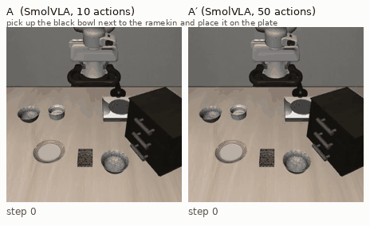

# How many rollouts? A statistically rigorous evaluation of VLA policies on LIBERO

**Telling apart two LIBERO policies that differ by 2 points takes about 4,100 rollouts per
policy. Running both policies on the same initial states and seeds cuts that to about 2,600
(−37%).**
<sub>80% power, two-sided α = 0.05, every task run equally often. The paired number assumes
two policies as correlated as SmolVLA run with two inference settings (Figure 3).</sub>




*One key, two policies: the same SmolVLA checkpoint on the same initial state with the same
random numbers. Executing 10 actions per chunk (left), it places the bowl at step 107. Executing
50 (right), it leaves the bowl on the rim of the plate and runs out of time.*

## What this is

VLA papers report LIBERO success rates of 95% or more, and leaderboards rank models a point or
two apart. This repository measures how much of such a number is noise, on 6,000 simulated
rollouts of three open checkpoints, and ships the small toolkit used to do it.

- **Suite:** `libero_spatial`, 10 tasks × 50 initial states × 4 seeds = 2,000 episodes per
  policy, the same keys for every policy.
- **Policies:**
  - **A:** `lerobot/smolvla_libero`, executing 10 actions per chunk.
  - **A′:** the same checkpoint, executing 50.
  - **B:** `lerobot/pi05_libero_finetuned`, executing 10.
- **Questions** (fixed in advance in [docs/plan.md](docs/plan.md)):
  - **RQ1:** how uncertain is one success rate, and where does the noise come from?
  - **RQ2:** how many rollouts does it take to tell two policies apart, paired or unpaired?
  - **RQ3:** how many if the evaluator may stop early?

The write-up is [docs/report.md](docs/report.md), and every run is logged in
[docs/lab_notebook.md](docs/lab_notebook.md).

## Key findings

1. **A success rate at 10 episodes per task is good to about ± 6 points** (Figure 1). A
   reported 78% for A is 78 ± 6.4, A′'s 58% is 58 ± 8.6, and B's 97% is 97 ± 3.0. The binomial
   formula says ± 8.1 for A: too wide, because the 10 tasks are fixed and their differences
   add no uncertainty. With several seeds per initial state the binomial interval becomes too
   narrow instead (design effect 1.4 to 1.7 on our grid). The seed alone accounts for 37% to
   77% of the variance of one episode.
   
2. **Pairing pays within one model, hardly between two** (Figure 2).
   - **A vs A′** (20 points apart): 80% power takes 87 rollouts per policy unpaired and 54
     paired (−38%).
   - **A vs B** (19 points apart): pairing gains nothing at fixed n (44 against 39), because
     few pairs disagree and the exact McNemar test is coarse on few pairs.
   - **With every task run equally often**, the formula's saving is 26% for A vs A′ and 3% for
     A vs B.
   
3. **Small gaps need thousands of rollouts** (Figure 3). A 2-point gap takes about 4,100
   rollouts per policy, or about 2,600 paired. Under the assumptions fixed in the plan (a
   random task for each rollout, discordant pairs held at their A vs A′ rate) it takes 6,700
   and 5,200. Both versions are on the chart.
4. **Sequential tests decide early without knowing the gap** (Figure 4). With a budget of 500
   rollouts per policy, every simulated evaluation decided. A vs A′ was decided after 99
   rollouts on average with STEP (unpaired) and 61 with the paired sequential McNemar test
   derived here; A vs B after 56 and 52. Under the null both reject 5.0% to 5.2% of the time.
   

## Recommendations for practitioners

- **Run every task equally often and use an interval that matches the design.** Bootstrap the
  initial states within each task (`bootstrap_rate`). A binomial interval is conservative only
  with one seed per initial state.
- **Compare variants of one model on the same initial states and seeds.** The gain is large
  when the policies share their failures. Between different models, expect little.
- **At small n, compute power by resampling, not with the normal formula.** The formula
  overstated the power of the exact McNemar test by up to 9 points.
- **When the gap is unknown, use a sequential test with a budget.** Here every evaluation
  decided, after a fifth of the budget or less on average. Reaching the budget without a
  decision is not evidence that two policies are equal.
- **Do not assume an episode replays from its key alone.** In LeRobot's LIBERO environment an
  episode can depend on the episodes run before it in the same environment. 59 of 60 random
  keys replayed exactly in a fresh environment; replaying a whole run in its order reproduced
  it bit for bit.

## Reproduce

Environment with [uv](https://docs.astral.sh/uv/). LeRobot 0.6.1 and every other version are
pinned in `uv.lock`.

```bash
uv sync                    # GPU machine: LeRobot, LIBERO, the policies
uv sync --no-group sim     # CPU only: the statistics, the tables and the figures
source env.sh              # caches on local disk and MUJOCO_GL=egl; edit its paths first
```

| Step | Command | Compute |
|---|---|---|
| Smoke test | `scripts/smoke_test.sh` | GPU, minutes |
| Harness checks, throughput | `scripts/run_grid.sh --grid configs/grid_throughput.yaml`, then `uv run scripts/analyze_throughput.py` and `uv run scripts/check_harness.py` | GPU, under 1 h |
| Sanity check | `scripts/step3.sh` | GPU, under 1 h |
| Main grid | `scripts/run_grid.sh --grid configs/grid_main.yaml --policies smolvla_n10` (and `smolvla`, `pi05`), inside `scripts/tmux_run.sh`; resumable | GPU, 3.5 to 4.8 h per policy on an RTX A5000 |
| Every table and figure | `scripts/make_figures.sh` (add `--with-validation` for the simulation tables) | CPU, 1.5 min (+7 min) |
| Videos of discordant episodes | `uv run scripts/rerun_with_video.py`, then `uv run scripts/make_rollout_gif.py` | GPU, 5 min |
| Replay checks | `uv run scripts/check_replay.py`, `uv run scripts/replay_shard.py ...` | GPU, about 10 min each |

The per-episode results of the main grid are in `results/raw/main/` (624 KB, tracked), so a
fresh clone rebuilds every table and figure on CPU with `scripts/make_figures.sh`.

## Toolkit

`evalstats.stats` works on any per-episode table with columns `task_id`, `init_state_id`, `seed`
and `success`:

```python
import numpy as np
import pandas as pd

from evalstats.stats.exact import mcnemar_pvalue
from evalstats.stats.intervals import bootstrap_gap, bootstrap_rate
from evalstats.stats.variance import components, design_effect, episodes_to_array

# One row per episode: task_id, init_state_id, seed, success. Same keys for both policies.
a = episodes_to_array(pd.read_csv("policy_a.csv"))
b = episodes_to_array(pd.read_csv("policy_b.csv"))
rng = np.random.default_rng(0)

print(components(a))                               # variance: between tasks, states, seeds
print(design_effect(components(a), n_seeds=1))     # < 1: binomial interval too wide
print(bootstrap_rate(a, rng=rng))                  # 95% interval, states resampled per task
print(bootstrap_gap(a, b, rng=rng))                # 95% interval for the paired gap
d = (b - a).ravel()
print(mcnemar_pvalue((d < 0).sum(), (d > 0).sum()))  # paired exact test
```

The toolkit also provides:
- **`exact.barnard_region`:** Barnard's test for whole power simulations, checked against scipy.
- **`power.resampled_power` and `power.formula_n`:** power by resampling and the sample-size
  formula.
- **`sequential.sequential_mcnemar`:** the exact paired sequential test.
- **`step.run_step`:** a wrapper around STEP.
- **`simulate.NestedBernoulli`:** the simulator the toolkit is validated on.

Every method is validated on simulated data with known truth: `tests/` and
`scripts/validate_stats.py`.

## Limitations

- One suite (`libero_spatial`), simulation only, three policy variants, one of which differs
  from another only by an inference setting.
- **Both observed gaps are large** (about 20 points). Small gaps are covered by the null
  controls and by the formula in Figure 3, which rests on stated assumptions.
- **Power figures and stopping times are plug-in estimates:** the measured grid plays the
  population.
- **Post-hoc analyses are labelled as such** in the notebook. These are the designs that run
  every task equally often, the power curves below n = 50 and the second base rate of
  Figure 3.
- **Sequential results hold for one budget (500) and one way of spending the risk** (uniform).
- **The SmolVLA checkpoint scores below its paper's number** (79% on the sanity check against
  90%); the paper's run is a different training run. π0.5 reproduces its published rate (98%
  against 97%).
- **STEP comes from its authors' package** (`sequentialized_barnard_tests`, CC BY-NC 4.0). It
  is a dependency only; none of its code is in this repository.

## References

- Kress-Gazit et al., *Robot Learning as an Empirical Science: Best Practices for Policy
  Evaluation*, 2024. [arXiv:2409.09491](https://arxiv.org/abs/2409.09491)
- Snyder et al., *Is Your Imitation Learning Policy Better than Mine? Policy Comparison with
  Near-Optimal Stopping* (STEP), 2025. [arXiv:2503.10966](https://arxiv.org/abs/2503.10966)
- Lan and DeMets, *Discrete sequential boundaries for clinical trials*, Biometrika 70(3), 1983.
- *Beyond Binary Success: Sample-Efficient and Statistically Rigorous Robot Policy Comparison*
  (N-SCORE). [arXiv:2603.13616](https://arxiv.org/abs/2603.13616)
- LeRobot LIBERO documentation: [huggingface.co/docs/lerobot/en/libero](https://huggingface.co/docs/lerobot/en/libero)
- SmolVLA: [arXiv:2506.01844](https://arxiv.org/abs/2506.01844)

MIT License. See [LICENSE](LICENSE).
