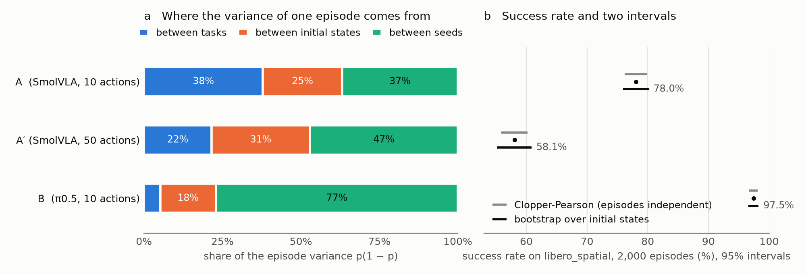
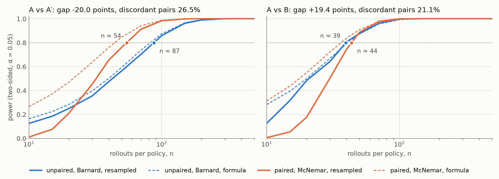
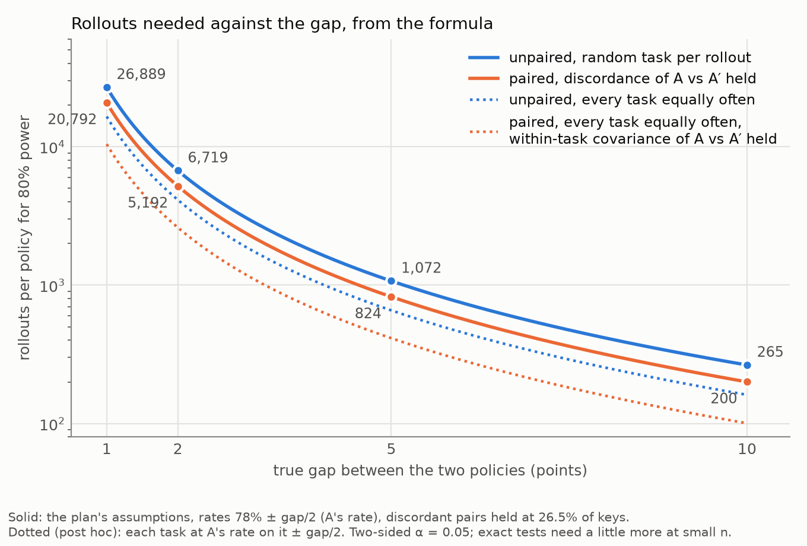
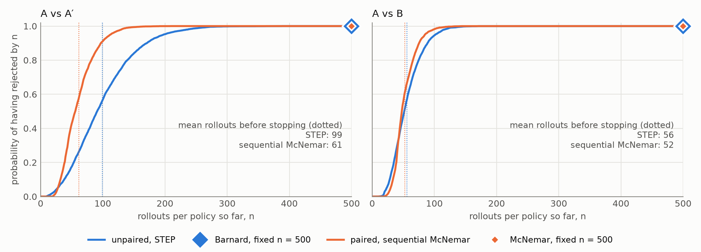

# How many rollouts? A statistically rigorous evaluation of VLA policies on LIBERO

Nicholas Dreesen, October 2026

## 1. Question

Vision-language-action (VLA) policies are compared on LIBERO with success rates measured on a
few hundred simulated rollouts, and published numbers often differ by one or two points. This
report measures, on open checkpoints, how much of such a number is noise. It asks three
questions, fixed in advance in `docs/plan.md`:

- **RQ1.** How uncertain is one success rate, and where does its variance come from?
- **RQ2.** How many rollouts does it take to tell two policies apart, and how much does a
  paired design save?
- **RQ3.** How many rollouts if the evaluator may stop as soon as the evidence suffices?

The questions are linked. The noise two policies share (hard tasks, hard initial states,
unlucky random numbers) is what RQ1 measures, and what pairing removes in RQ2 and RQ3.

## 2. Setup

**Benchmark.** `libero_spatial` through LeRobot 0.6.1: 10 tasks, 50 initial states per task
shipped with LIBERO, a 280-step limit, and success as LIBERO's task flag.

**Policies.**

| Name | Checkpoint | Inference setting |
|---|---|---|
| A | `lerobot/smolvla_libero` | executes 10 actions per predicted chunk |
| A′ | same checkpoint | executes 50 (the checkpoint's default) |
| B | `lerobot/pi05_libero_finetuned` | executes 10, `torch.compile` off |

A and A′ differ only in how often they replan; A and B are different models. These are the two
comparisons planned, and no others were made.

**Grid.** Every policy runs the same 2,000 keys (task, initial state, seed): 10 tasks × 50
states × 4 seeds. The harness derives all randomness of an episode (policy noise, simulator)
from its key, so two policies on the same key start from the same scene with the same random
numbers. It writes one row per episode and resumes after a crash without repeating an episode.
The 6,000 episodes ran on three RTX A5000 machines, one per policy, in about 12 GPU-hours.
Every planned key is stored exactly once, and no episode crashed.

**Sanity check.** On 100 keys per policy before the grid, B scored 98% against a published 97%.
A scored 79% against the 90% of the SmolVLA paper, whose number comes from another training
run. A′ scored 59%.

**Estimand.** Tasks are fixed and equally weighted; initial states and seeds are random:
$p_\pi = \tfrac{1}{10}\sum_t \mathbb{E}_{i,s}[Y_\pi(t,i,s)]$. Every claim is about these 10
tasks.

## 3. Methods

All code is in `src/evalstats/stats/`. Every method was first validated on a simulator with
known truth (Section 3.6).

### 3.1 Variance components

With a uniformly random task, the law of total variance splits one episode's variance:

$$p(1-p) = \sigma^2_{\text{task}} + \sigma^2_{\text{init}} + \sigma^2_{\text{seed}},$$

between tasks, between initial states within a task, and between seeds on one initial state.
Each is estimated with the unbiased moment estimator of the balanced nested design, and the
covariance between two policies is split the same way. A protocol with $K$ states per task and
$m$ seeds per state estimates $p$ with variance
$\sigma^2_{\text{init}}/(10K) + \sigma^2_{\text{seed}}/(10Km)$. Dividing by the binomial
$p(1-p)/(10Km)$ gives the design effect $(m\sigma^2_{\text{init}} + \sigma^2_{\text{seed}}) /
p(1-p)$.

### 3.2 Intervals

**Naive.** Clopper-Pearson on the pooled count. **Cluster-aware.** A percentile bootstrap
(10,000 replicates) that resamples the 50 initial states of each task with replacement and
keeps the 4 seeds of a state together. The same draw is applied to both policies, so the
interval for a gap is paired.

### 3.3 Fixed-n tests and power

Keys are drawn uniformly from the grid; $n$ is the number of rollouts per policy.

- **Unpaired design:** independent keys for each policy, tested with Barnard's exact test.
  scipy's `barnard_exact` is too slow to call on every simulated table, so the rejection region
  is computed once per $n$. Tables are ordered by the pooled Wald statistic, and the critical
  value is the smallest whose worst-case size over the common rate is at most α. The region
  matches scipy on every table for six sizes from $n = 5$ to $n = 30$.
- **Paired design:** the same keys for both policies, tested with McNemar's exact test.

Power is the rejection rate over 5,000 simulated evaluations. With $b$ and $c$ the
probabilities that only one or only the other policy succeeds, the variance of a paired
difference is $\sigma^2_{\text{paired}} = b + c - (c-b)^2 = \sigma^2_{\text{unpaired}} -
2\,\mathrm{Cov}$. The sample-size formula is $n \approx (z_{0.975} + z_{0.8})^2\sigma^2/\delta^2$.
The ratio of the paired to the unpaired $n$ is therefore one minus twice the covariance over
$\sigma^2_{\text{unpaired}}$. The covariance splits by level like the variance.

### 3.4 Sequential McNemar test

Both policies run on the same key at each step. Let $D_n \in \{-1, 0, 1\}$ be the difference of
their outcomes on the $n$-th key, and $W_k$ the sum of the first $k$ non-zero differences.

1. **No nuisance parameter.** The pairs are independent and identically distributed. Given
   the whole sequence of indicators $B_n = |D_n|$, the signs of the discordant pairs are
   independent, each $+1$ with probability $c/(b+c)$. Under $H_0: p_A = p_B$ that probability
   is $1/2$, so $W_k$ is a symmetric simple random walk whatever the rate of discordant pairs.
2. **Boundary.** Let $n_k$ be the step at which the $k$-th discordant pair arrives, and $N$ the
   budget. The test rejects at $n_k$ if $|W_k| \ge a_k$, where $a_k$ is the smallest integer
   such that
   $$\Pr\nolimits_{H_0}\big(\exists j \le k: |W_j| \ge a_j\big) \le \alpha\, n_k / N.$$
   The left side is computed exactly by propagating the distribution of the walk over the
   paths that have not stopped. Risk left unspent because the walk is discrete carries over.
   The test also looks once at $n = N$, where it may use all the risk left.
3. **Validity.** Given $(B_n)$, the thresholds are fixed numbers, and a symmetric walk crosses
   them with probability at most α by construction. This holds for every sequence $(B_n)$,
   hence unconditionally and for every discordance rate, in finite samples.
4. **Relation to known tests.** With all the risk at $n = N$ the test is McNemar's exact test.
   Spending risk with the rollout count is the alpha-spending idea of Lan and DeMets (1983),
   computed exactly.

The look at $n = N$ was added while implementing the test, after the grid was run and before
any comparison was computed. Without it, item 4 holds only when the last pair happens to be
discordant. The plan was amended accordingly.

### 3.5 STEP

The unpaired sequential test is STEP (Snyder et al., 2025), from its authors' package, at
budget 500. It is one-sided, so it runs in both directions at α/2 (`MirroredStepTest`,
"ranking" mode). Its decision policy for α/2 = 0.025 took about 4 minutes of CPU to
synthesize.

### 3.6 Validation

The simulator is a nested Bernoulli model with chosen components and a chosen correlation
between two policies at each level. On the grid's layout, in six regimes:

- **Recovery:** the moment estimators recover all 30 true components and covariances, within
  1.7 Monte Carlo standard errors.
- **Coverage:** the bootstrap interval covers the rate 94.4% to 95.5% of the time. The bootstrap
  intervals of the components cover 90% to 96%; the state component is the weakest.
  Clopper-Pearson goes wrong in the direction the design effect predicts: 79% at a design
  effect of 2.6, and 98% at 0.70.
- **Type-I error:** with 20,000 evaluations each, all 38 rejection rates are compatible with 5%.
  Barnard rejects 4.2% to 5.0%, McNemar 0.4% to 4.6%, the sequential McNemar test 3.2% to 5.1%
  for discordance rates from 2% to 50%, and STEP 4.8% to 5.3%. A brute-force enumeration
  confirms that the sequential boundary is exact and that no threshold can be lowered.
- **Power:** resampled power is within 2.5 points of the formula for Barnard. Exact McNemar is
  up to 9 points below the formula at small $n$, and 2.6 to 3.9 points below at the formula's
  $n$ for 80%.

## 4. Results

### 4.1 RQ1: one success rate

**Table 1.** Success rates, variance shares, and half-width $Y$ (1.96 standard deviations)
predicted for the protocols with one seed per initial state. Intervals are 95% bootstrap
intervals.

| | A | A′ | B |
|---|---|---|---|
| Successes / 2,000 | 1,561 (78.0%) | 1,161 (58.1%) | 1,949 (97.5%) |
| Clopper-Pearson / bootstrap | [76.2, 79.9] / [75.9, 80.2] | [55.9, 60.2] / [55.2, 60.9] | [96.7, 98.1] / [96.6, 98.3] |
| Share between tasks | 38% [34, 44] | 22% [19, 26] | 5% [3, 10] |
| Share between states | 25% [19, 30] | 31% [26, 35] | 18% [9, 25] |
| Share between seeds | 37% [32, 42] | 47% [43, 52] | 77% [68, 87] |
| Design effect, 4 seeds (this grid) | 1.38 | 1.73 | 1.48 |
| Design effect, 1 seed | 0.62 | 0.78 | 0.95 |
| $Y$, 10 per task (binomial) | ± 6.4 (± 8.1) | ± 8.6 (± 9.7) | ± 3.0 (± 3.1) |
| $Y$, 50 per task (binomial) | ± 2.9 (± 3.6) | ± 3.8 (± 4.3) | ± 1.4 (± 1.4) |

**Figure 1.** (a) Shares of the variance of one episode. (b) Success rates with both intervals.

A reported 78% for A at 10 episodes per task is really 78 ± 6.4 points. The binomial interval
errs in opposite directions depending on the protocol:

- **With one seed per state, it is too wide.** The tasks are fixed, so their differences (38%
  of the variance for A) add no uncertainty.
- **With four seeds per state, it is too narrow.** The seeds of one state share its
  difficulty. On the grid the bootstrap interval is 1.15 to 1.30 times wider than
  Clopper-Pearson, close to the square root of the design effect.

The seed alone carries 37% to 77% of the variance: rerunning one initial state with other
random numbers changes the outcome often. B is near the ceiling, which suggests that its rare
failures are mostly bad luck on states it usually solves rather than hard states.

### 4.2 RQ2: telling two policies apart

**Table 2.** Gaps, discordance, covariance split and rollouts per policy for 80% power. The
"tasks balanced" rows (post hoc) run every task equally often in both designs.

| | A vs A′ | A vs B |
|---|---|---|
| Gap (second − first) | −20.0 [−22.7, −17.3] | +19.4 [+17.2, +21.7] |
| Only A succeeds / only the other | 23.3% / 3.3% | 0.9% / 20.3% |
| Saving predicted, 2 Cov / σ²_unpaired | 46% [41, 50] | 12% [7, 17] |
| … from shared task / state / seed | 27% / 14% / 4% | 10% / 1% / 1% |
| n for 80%, resampled: unpaired / paired | 87 / 54 (−38%) | 39 / 44 (+10%) |
| n for 80%, formula: unpaired / paired | 81 / 44 | 41 / 36 |
| Saving predicted, tasks balanced | 26% [20, 31] | 3% [−1, 7] |

**Figure 2.** Power against $n$; solid lines are resampled from the grid, dashed lines are the
formula.

- **Within one model, pairing saves 38%.** A and A′ share most of their difficulty, mainly
  which tasks are hard (27 points of the 46 predicted), then which states (14) and which
  random numbers (4).
- **Between two models, pairing does not pay at this gap.** The predicted 12% comes almost all
  from shared task difficulty. At $n \approx 40$ there are only about 8 discordant pairs, and
  exact McNemar loses more to their discreteness than pairing gains.
- **Null control.** A against itself on the same states with other seeds: Barnard rejects 4.2%
  to 5.2% and McNemar 0.05% to 4.6% of the time.

**Most of the saving comes from running each task equally often, which pairing also does.**
The plan's unpaired design draws a random task for every rollout. An evaluator who balances
tasks without pairing already removes the shared-task part. Against that baseline, pairing
initial states and seeds saves 26% for A vs A′ and nothing measurable for A vs B. This
comparison was not planned; it is reported because the headline depends on it.

**Figure 3.** Rollouts per policy for 80% power against a hypothetical gap, from the formula.

- **Plan's assumptions (solid lines):** a random task per rollout, rates of A's 78% ± gap/2,
  and discordant pairs held at A vs A′'s 26.5%. A 2-point gap then takes 6,719 rollouts
  unpaired and 5,192 paired (−23%). With rates around the A, A′ average instead, the saving is
  39%.
- **Tasks balanced (dotted lines, post hoc):** every task run equally often, at A's rate on
  that task ± gap/2, with A vs A′'s within-task covariance held. A 2-point gap then takes 4,129
  rollouts unpaired and 2,607 paired (−37%).
- **The plan's discordance assumption fails in this setting.** Holding 26.5% discordant pairs
  at a 2-point gap implies two policies that agree on a task *less* often than independent
  ones would, and pairing then costs 26%. Holding the covariance instead is the more
  defensible extrapolation. Both rest on the correlation of one pair of policies, a variant of
  one model.

**Failure modes.** Ten discordant A vs A′ keys were re-run with video, five in each direction.
They are near misses, not gross errors.
- In 8 of 10 the failing policy grasps the right bowl and brings it to the plate. The bowl then
  ends off-centre, across the rim or tilted, LIBERO does not count it as placed, and the policy
  adjusts or hovers until the step limit.
- The other 2 are missed grasps, one in the drawer task.
- No episode picks the wrong object.
- Both settings fail the same ways, which fits the large seed share of RQ1.

### 4.3 RQ3: stopping early

**Table 3.** Budget 500 rollouts per policy, 5,000 simulated evaluations per design, two-sided
α = 0.05.

| | Design | Power within 500 | Mean rollouts | 90th percentile |
|---|---|---|---|---|
| A vs A′ | STEP (unpaired) | 100% | 99 | 171 |
| | sequential McNemar (paired) | 100% | 61 | 97 |
| | Barnard / McNemar at fixed n = 500 | 100% / 100% | 500 | — |
| A vs B | STEP (unpaired) | 100% | 56 | 89 |
| | sequential McNemar (paired) | 100% | 52 | 76 |
| | Barnard / McNemar at fixed n = 500 | 100% / 100% | 500 | — |

**Figure 4.** Probability of having rejected by $n$; diamonds mark fixed-n power at 500.

With a budget of 500 rollouts per policy:
- **A vs A′** is decided after about 99 rollouts unpaired and 61 paired (−38%).
- **A vs B** is decided after about 56 and 52 (−6%).
- **Every evaluation decides**, and none in the wrong direction.

The paired sequential test keeps the paired advantage for A vs B, where fixed-n McNemar lost
it, because it spends its risk over the walk of discordant pairs. The sequential tests do not
know the gap, yet stop only 13% to 42% later than a fixed design that knew it and aimed at 80%
power. Under the null, STEP rejects 5.22% [4.91, 5.53] of the time and the sequential McNemar
test 5.01% [4.71, 5.32].

## 5. Reproducibility

- **What is tracked.** Code, configs and the 6,000 per-episode rows (`results/raw/main/`) are
  in the repository. `scripts/make_figures.sh` rebuilds every table and figure in 1.5 minutes
  of CPU; a fresh copy of the repository reproduced them exactly.
- **Replays.** Episodes were replayed to check that keys determine outcomes:
  - 59 of 60 random keys replayed identically in a fresh environment. All 40 A and B keys
    matched across machines.
  - One A′ key on the drawer task did not: it was stored as a success at step 132 and fails
    from a fresh environment, every time.
  - Replaying its 80-episode run in order, in one environment, reproduced all 80 episodes, that
    one included. An episode can therefore depend on the episodes run before it in the same
    environment; the state a reset leaves behind is not identified.
- **Effect on the statistics.** None that biases them: the carry-over acts as extra noise, and
  every policy ran its keys in the same order.

## 6. Limitations

- **Scope.** One suite, simulation only, three policy variants, two of them one model.
- **Gap size.** Both observed gaps are about 20 points. Small gaps are covered only by the null
  controls and by Figure 3, which extrapolates from one pair of policies.
- **Plug-in estimates.** Power figures and stopping times treat the measured grid as the
  population.
- **Sequential settings.** One budget (500) and one way of spending the risk (uniform). The
  sequential McNemar test is valid but not claimed to be optimal.
- **Initial states** are assumed to be independent draws; LIBERO does not document how its 50
  were generated.
- **Post-hoc analyses** are labelled in the lab notebook: the task-balanced designs, the power
  curves below n = 50, the second base rate of Figure 3, and the replay checks.

## References

- Kress-Gazit et al. *Robot Learning as an Empirical Science: Best Practices for Policy
  Evaluation.* arXiv:2409.09491, 2024.
- Snyder et al. *Is Your Imitation Learning Policy Better than Mine? Policy Comparison with
  Near-Optimal Stopping.* arXiv:2503.10966, 2025.
- Lan and DeMets. *Discrete sequential boundaries for clinical trials.*
  Biometrika 70(3), 1983.
- *Beyond Binary Success: Sample-Efficient and Statistically Rigorous Robot Policy Comparison*
  (N-SCORE). arXiv:2603.13616.
- *SmolVLA.* arXiv:2506.01844, 2025.
- LeRobot LIBERO documentation, huggingface.co/docs/lerobot/en/libero.
